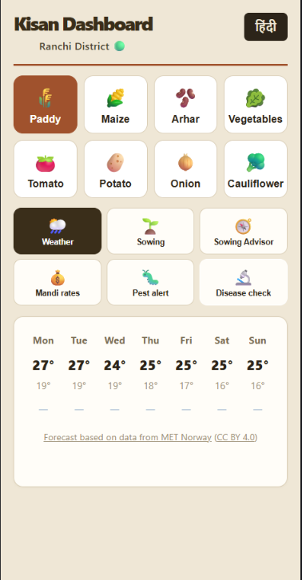
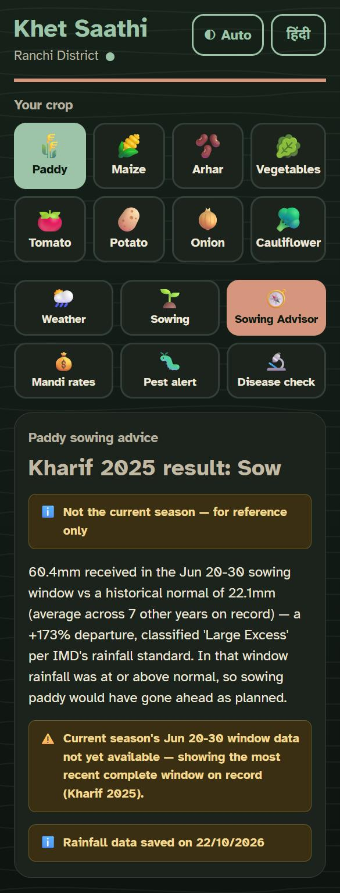
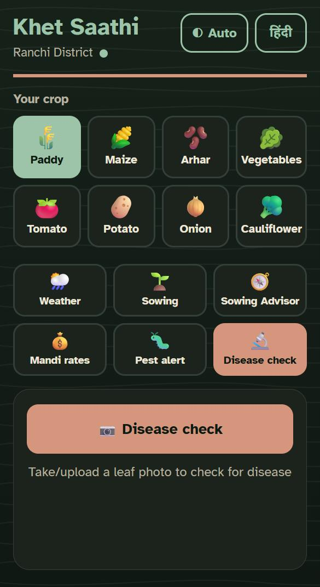
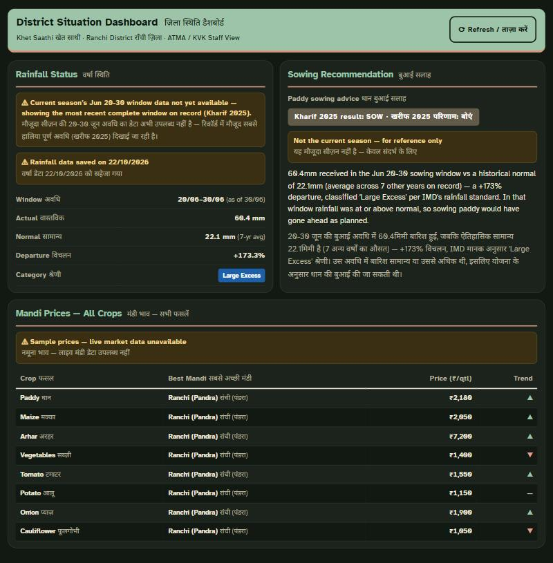

# Kisan Dashboard

A bilingual (Hindi/English) crop advisory web app for smallholder farmers in Ranchi district, Jharkhand.
FastAPI backend · React frontend · CNN-based crop disease detection · Agmarknet mandi prices (live when run
locally; see [Known limitations](#known-limitations-of-the-hosted-demo)).

**Live demo:** https://kisan-dashboard.vercel.app (staff view at `/staff`)

## Screenshots

*Weather: 7-day forecast from live data, with the provider credit (here MET Norway, the failover source).*

*Sowing advisor: last season's result (Kharif 2025), clearly labelled as not the current season and for reference only.*

*Disease check: paddy disease detection from a leaf photo, with confidence and what to do.*

*Staff dashboard (`/staff`): district view for extension staff; mandi prices are labelled as sample data.*

---

## Why this exists

India already has national-scale digital agriculture platforms. This project is **not** an attempt to
replace them — it exists to close the district-level gaps they leave open.

### What already exists nationally

- **Bharat-VISTAAR** (launched February 2026) is an AI-based advisory platform providing weather,
  mandi prices, pest and disease management, soil health, crop advisory and scheme information in
  one place, accessed via phone call and chatbot, with a mobile app planned. Phase 1 launched in
  Hindi and English.
  Source: [newsonair.gov.in](https://newsonair.gov.in/union-minister-for-agriculture-to-launch-ai-based-farmer-platform-bharat-vistaar-in-jaipur/)

- **Kisan e-Mitra**, a voice-based AI chatbot, supports 11 regional languages and handles over
  8,000 farmer queries daily (93 lakh+ answered to date) — clear evidence that voice-first, local-language
  interfaces are what this user base actually adopts.
  Source: [PIB, Dec 2025](https://www.pib.gov.in/PressReleasePage.aspx?PRID=2204751)

### The gaps these platforms do not close in Ranchi

**1. Rainfed upland reality.** Ranchi district agriculture is overwhelmingly rainfed upland farming.
Yields of rainfed upland rice are below 1,000 kg/ha and unstable, and small and marginal farmers make up
roughly 75% of total farm holdings. The district's own strategic research plan recommends replacing
rainfed upland rice with lower-water, higher-value crops — maize, ragi, black gram, pigeon pea, cowpea,
groundnut, niger and sweet potato.
Source: [ATMA Ranchi, Strategic Research & Extension Plan, Ch. 9](http://www.atmaranchi.in/srep/chapter9.pdf)

National advisory platforms give generic weather forecasts. What a Ranchi farmer needs is a **sowing-window
decision**: given rainfall to date, is it still viable to sow paddy, or is it time to switch to maize or ragi?

**2. Monsoon failure is the binding constraint.** In July 2024, roughly 86% of Jharkhand's paddy-intended
arable land was still lying fallow amid a 47% rainfall deficit; 158 blocks across 17 districts were declared
drought-hit in 2023, and 226 blocks in 2022.
Source: [Business Standard / PTI, July 2024](https://www.business-standard.com/industry/agriculture/86-of-jharkhand-s-paddy-cultivation-land-unused-due-to-scanty-rainfall-124072700321_1.html)

**3. Crop coverage mismatch.** General-purpose disease-detection models are trained on mainstream crop sets.
Ranchi's actual crops — paddy, arhar, maize, and tribal-belt vegetables — are underrepresented. Closing this
gap requires a locally retrained classifier, not a national one.

### What this project does differently

| | National platforms | Kisan Dashboard |
|---|---|---|
| Scope | Pan-India, generic | Ranchi district, block-level |
| Advisory | Generic weather forecast | Rainfed **sowing-window** decision (sow paddy / switch crop / wait) |
| Disease model | Broad crop set | Paddy model trained on the Paddy Doctor dataset (paddy is Ranchi's main crop); other crops use PlantVillage; arhar planned |
| Audience | Farmers only | Farmers **+** a district dashboard view for extension staff (ATMA/KVK) |

---

## Roadmap

- [x] **Phase 0** — Full-stack app: CNN disease detection, bilingual disease info, weather and mandi endpoints
- [x] **Phase 1** — Expanded crop coverage; live Agmarknet mandi API wired in, with graceful fallback (live locally; the hosted demo serves sample prices — see [Known limitations](#known-limitations-of-the-hosted-demo))
- [ ] **Phase 2** — Locally retrained disease classifier (paddy, arhar)
- [x] **Phase 3** — Rainfed sowing-advisor: live rainfall (data.gov.in, NRSC VIC model, Ranchi district) feeds a
      `/sowing-advisory` endpoint that assesses cumulative rainfall over the Jun 20-30 sowing-decision window —
      the recommended sowing time for upland rice, maize and pigeon pea per ATMA Ranchi's SREP, Chapter 9 — and
      classifies it into sow / wait / switch using IMD's official departure-from-normal rainfall standard (Large
      Excess / Excess / Normal / Deficient / Large Deficient / No Rain), with "normal" computed as a leave-one-out
      historical average across the other years on record (the assessed season's own rainfall never feeds its own
      baseline). Bilingual (Hindi/English) reasoning cites the actual departure %, category, and both actual and
      normal mm figures, surfaced in a dedicated frontend tab. When current-season data isn't yet available from
      the upstream feed, it falls back to the most recent complete window and labels the response accordingly —
      an honest data-availability signal, not a bug.
- [ ] **Phase 4** — District dashboard: block-level rainfall, sowing progress and disease reports for extension staff

Not done yet:

- [ ] Crop sections with sourced vegetable data
- [ ] Redesign
- [ ] Arhar disease detection (see Phase 2)
- [ ] India-hosted live mandi and rainfall data (see [Known limitations](#known-limitations-of-the-hosted-demo))
- [ ] Usage logging

### Bug fixed during Phase 3

While wiring up the rainfall fetch, `api.data.gov.in` was found to silently stall — no response, no error,
just a hung connection — on `requests`' default User-Agent header, presumably a bot filter. A curl-like
User-Agent fixed it instantly. The same silent stall was also affecting the **already-shipped Agmarknet mandi
endpoint**, causing it to time out and quietly fall back to sample data on every call. Both endpoints now share
a `DATAGOV_HEADERS` constant with the fix.

---

## Deployment

| Part | Where | Notes |
|---|---|---|
| Frontend | [Vercel](https://kisan-dashboard.vercel.app) | Root directory `frontend/app`; `VITE_API_BASE` env var points at the backend. `vercel.json` rewrites every path to `index.html` so `/staff` loads directly. |
| Backend | Render free tier, Singapore region | Free instances sleep after 15 minutes idle; the first request after that takes about 50 seconds (cold start). `DATAGOV_API_KEY` is set as a Render environment variable. |

Besides local runs, the app was also tested on the hosted demo, including the free-tier cold start (about 50 s).

Both disease models are served as **TensorFlow Lite** via `ai-edge-litert` rather than full TensorFlow, so the
backend fits in the free tier's 512 MB RAM. `backend/convert_to_tflite.py` converts the Keras models;
`backend/compare_models.py` runs an image through the Keras and TFLite PlantVillage models and prints the
predicted class and confidence from each — they matched on the images checked.

## Known limitations of the hosted demo

**Slow first load after idle.** The backend runs on Render's free tier, which sleeps after 15 minutes without traffic. The first visit after that can take about a minute to wake the server, and weather may briefly show as unavailable until it is up; refresh and it recovers.

**No live data.gov.in access from Render.** Render's servers cannot reach `api.data.gov.in`: Render's logs show
the connection being refused (Errno 111), while `example.com` was reachable from the same server (checked with a
temporary diagnostic endpoint, since removed). The same code fetches live data when run locally. So on the
hosted demo:

- **Rainfall** (and the sowing advisor) comes from a saved snapshot, `backend/data/rainfall_snapshot.json`
  (Ranchi district). It is refreshed by running `python refresh_snapshots.py` in `backend/` on a machine that can
  reach data.gov.in, then committing the file.
- **Mandi prices** are **sample** prices from the bundled `backend/data/mandi.json`. The refresh script can also
  save an Agmarknet snapshot, but Agmarknet only carries the current day's prices and had no Jharkhand records
  when the snapshots were taken, so no mandi snapshot exists yet.
- The UI labels both via the backend's `/data-status` endpoint: "Sample prices — live market data unavailable"
  on mandi tables, and "Rainfall data saved on <date>" on the sowing advisor.

The fallback order is live → snapshot → sample (mandi) or empty (rainfall). A real deployment for farmers
would need India-hosted infrastructure that can reach data.gov.in.

**Sowing advisor out of season.** Outside the Jun 20–30 window (or when the upstream feed hasn't caught up),
the advisor assesses the most recent complete window on record — currently Kharif 2025 — and says so in the
response and the UI.

## Weather forecast

The weather tab shows a live 7-day forecast for Ranchi, tried in this order:

1. **Open-Meteo** daily forecast.
2. **MET Norway Locationforecast** (`locationforecast/2.0/compact`) as failover. Its hourly/6-hourly data is
   aggregated to daily values by this app (high/low temperature, total rainfall, one condition per day). The UI
   credits it as "Forecast based on data from MET Norway (CC BY 4.0)", linking to MET Norway and the licence. Requests follow MET
   Norway's terms: an identifying User-Agent, at most 4 decimals in coordinates, no repeat request before the
   `Expires` time, and `If-Modified-Since` on repeat requests.
3. **Unavailable**: if both fail, the tab says "Weather forecast unavailable right now". No invented or sample
   forecast is ever shown.

The failover exists because on Render's shared free-tier IPs, Open-Meteo returned HTTP 429 (daily per-IP limit
exceeded).

Known limits:

- On the MET Norway fallback the forecast starts **tomorrow**: its data begins at the current hour, and partial
  days are dropped rather than shown with a misleading high/low.
- On the MET Norway fallback, highs/lows from day 3 on are less precise: the source data there is 6-hourly, so
  the true high or low can fall between readings.
- Thunderstorms are shown as "Rain"; there is no separate thunderstorm warning yet.

## Disease check

The disease check uses the crop the farmer has selected:

| Crop | Model | Notes |
|---|---|---|
| Paddy | Separate paddy model | 88% validation accuracy |
| Maize, potato, tomato | PlantVillage CNN (38 classes) | Prediction restricted to the selected crop's classes. If less than half the model's probability falls on that crop, it answers "This doesn't look like a <crop> leaf — please retake the photo" instead of guessing. |
| Vegetables, arhar, onion, cauliflower | None | Returns "Disease check is not available for this crop yet." — never a guessed disease. |

PlantVillage images are lab-condition photos (a single leaf on a plain background), so accuracy on field
photos is expected to be lower; it has not been measured. The UI shows "Trained on clear leaf photos; field
results may vary." under each result.

**Known gap:** the check cannot tell that a photo is not a leaf at all. In testing, a plain green image with
maize selected was reported as healthy maize at 100% confidence.

## Security

- CORS is restricted to the Vercel frontend (`https://kisan-dashboard.vercel.app`) and local development
  (`http://localhost:5173`).
- The data.gov.in API key is read only from the `DATAGOV_API_KEY` environment variable (`backend/.env` locally,
  which is gitignored; a Render environment variable in production). It is never hardcoded, and failed fetches
  log only the error type, since a traceback would include the request URL and key.

---

## Considered but deferred

**AlphaEarth Foundations** (Google Earth Engine satellite embeddings) was evaluated as a potential
land-use-history enhancement to the sowing advisor. Licensing was confirmed compatible (CC-BY 4.0), but the
approach was deprioritized: its 10m pixel resolution is coarse relative to individual field size, and its
annual-only update cadence isn't useful for in-season decisions. Kept as a possible future direction, not
pursued for now.

---

## Data sources

| Source | Use | Status |
|---|---|---|
| Agmarknet | Live mandi prices | Integrated (with fallback); sample prices on the hosted demo |
| data.gov.in (NRSC VIC model) | Rainfall for sowing-advisor | Integrated; saved snapshot on the hosted demo |
| Open-Meteo | 7-day weather forecast | Integrated (live) |
| MET Norway Locationforecast | 7-day weather forecast when Open-Meteo fails | Integrated (live failover) |
| ATMA Ranchi SREP | Crop-switch thresholds and recommended alternatives | Reference |
| PlantVillage | Base CNN weights (pre-trained, 38-class) | Integrated |

> **Note:** Bharat-VISTAAR and Kisan e-Mitra are cited above as *context and positioning*, not as data sources.
> Neither exposes a public API for integration.

---

## Acknowledgements & data sources

| Dataset / model | Used for | Source | License |
|---|---|---|---|
| PlantVillage | Maize, potato and tomato disease classes (38-class CNN) | Hughes & Salathé, [arXiv:1511.08060](https://arxiv.org/abs/1511.08060) | No licence file in the [GitHub repo](https://github.com/spMohanty/PlantVillage-Dataset) (citation requested); the [Zenodo record](https://zenodo.org/records/1204914) lists CC BY 4.0 but its description also mentions CC BY-SA 3.0 US, so the terms are inconsistent. Verify before any commercial use. |
| `trained_plant_disease_model.keras` | The PlantVillage CNN weights served by the backend | Source not recorded. The origin of these pre-trained weights was not documented when they were added. | Unknown |
| Paddy Doctor | Paddy disease model | "Paddy Doctor: A Visual Image Dataset for Automated Paddy Disease Classification and Benchmarking", [arXiv:2205.11108](https://arxiv.org/abs/2205.11108) | Released openly by the authors; the paper states no licence. Verify at [paddydoc.github.io](https://paddydoc.github.io/) before any commercial use. |
| Agmarknet (via data.gov.in) | Mandi prices | data.gov.in resource `9ef84268-d588-465a-a308-a864a43d0070` | Check source |
| District rainfall, NRSC VIC model (via data.gov.in) | Rainfall for the sowing advisor | data.gov.in resource `6c05cd1b-ed59-40c2-bc31-e314f39c6971` | Check source |
| Open-Meteo | 7-day weather forecast | [open-meteo.com](https://open-meteo.com/) | Data [CC BY 4.0](https://creativecommons.org/licenses/by/4.0/); the free API is for non-commercial use only ([terms](https://open-meteo.com/en/terms)) |
| MET Norway Locationforecast | Weather forecast failover; aggregated to daily values by this app | Based on data from MET Norway, [api.met.no](https://api.met.no/) | [CC BY 4.0](https://creativecommons.org/licenses/by/4.0/) |
| ATMA Ranchi Strategic Research & Extension Plan, Ch. 9 | Sowing window and alternative crops | [atmaranchi.in](http://www.atmaranchi.in/srep/chapter9.pdf) | Check source |
| India Meteorological Department (IMD) | Departure-from-normal rainfall categories | IMD rainfall classification standard | Check source |
